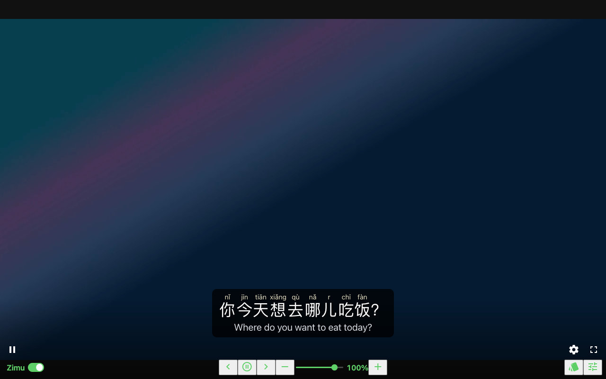
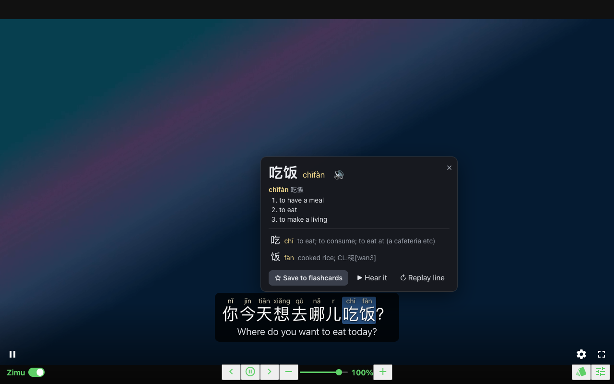
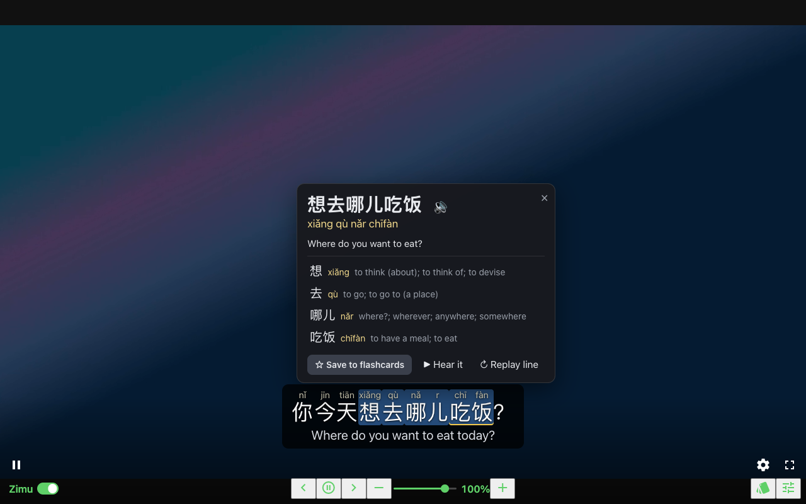
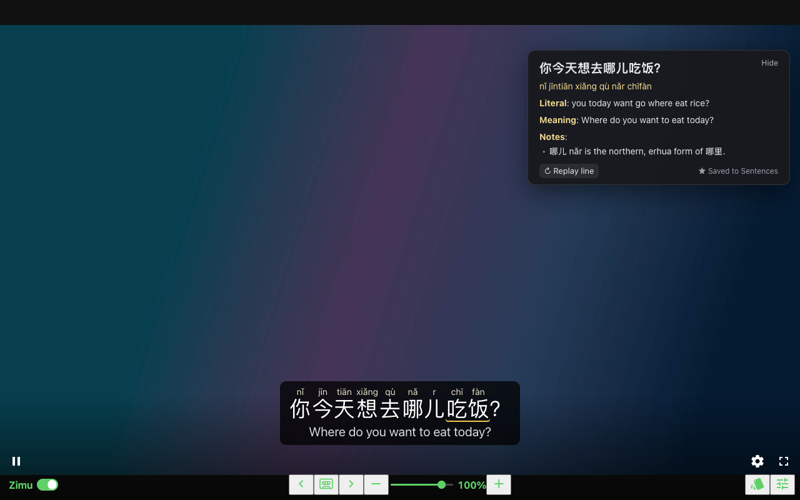
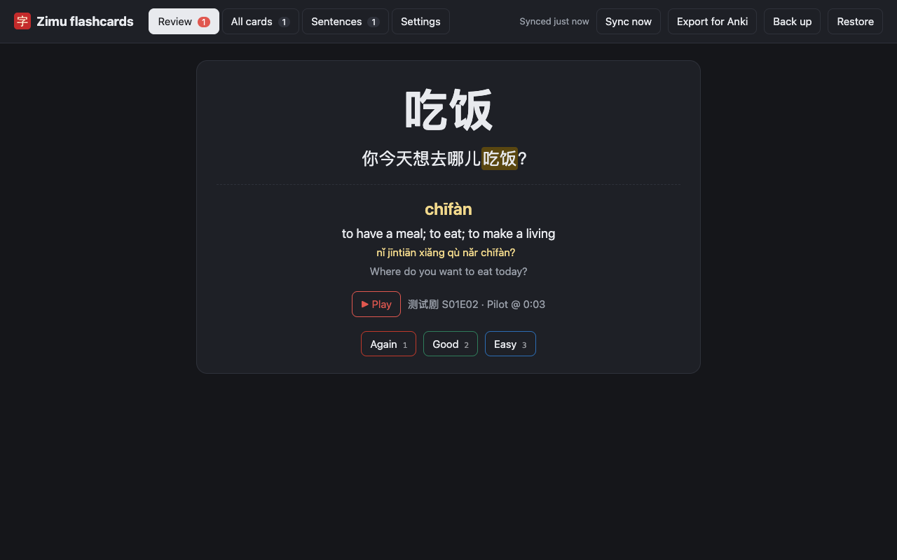
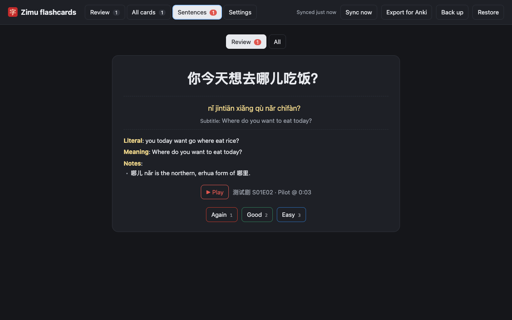

# Zimu 字幕

Mandarin learning subtitles for the **Jellyfin web player**, in the spirit of
Language Learning with Netflix. A browser extension for Chrome, Brave and
Zen/Firefox.

## Screenshots

<table>
<tr>
<td></td>
<td></td>
</tr>
<tr>
<td align="center">Hanzi, pinyin and English, with Zimu's row under Jellyfin's controls</td>
<td align="center">Click a word for its definitions and a character breakdown</td>
</tr>
<tr>
<td></td>
<td></td>
</tr>
<tr>
<td align="center">Drag across words to translate a phrase</td>
<td align="center">Click the line and Claude explains it</td>
</tr>
<tr>
<td></td>
<td></td>
</tr>
<tr>
<td align="center">Flashcards keep the sentence and the exact moment</td>
<td align="center">Sentence review</td>
</tr>
</table>

Taken by `npm run screenshots` against the fake Jellyfin the end-to-end tests
use, so the video behind the subtitles is a gradient rather than a show.

- **Hanzi, pinyin with tone marks and English**, each switchable on its own
  (hanzi + pinyin, English + pinyin, pinyin only, …). Pinyin is
  context-aware (还 hái/huán, 睡着 shuìzháo, 哪儿 nǎr).
- **Meanings** (⚙ ▸ Show): a short gloss under each word, in the pinyin's
  size and colour, so 咖啡 reads *kāfēi* above and *coffee* below. One
  everyday sense from CC-CEDICT, trimmed; words the dictionary lacks get an
  empty row so the line keeps its shape. Off by default.
- **Click a word** for its CC-CEDICT definitions, a character breakdown and
  a 🔊 pronunciation — and playback jumps to where that word is said and
  carries on (with Auto-pause on, it stops at the end of the line as usual).
  ▶ Hear it in the popup plays just the word and stops. Subtitles only time
  whole lines, so the word's moment is estimated from its position in the
  line (Mandarin runs at about one syllable per character); a short lead-in
  covers most misses. Turn it off under ⚙ if you only want definitions.
- **Drag across words** (or shift-click) to look up a phrase: machine
  translation and a word-by-word breakdown.
- **Click the subtitle box (not a word)** and Claude explains the line: a
  literal gloss, what it really means in context, how the English subtitle
  got there (and what it loosened or missed), and any slang, idioms or
  grammar worth knowing (小鲜肉 "little fresh meat" → a handsome young
  actor). Cut-off lines get a best guess at where they were heading.
  Opening one pauses the video. The panel (right-hand side) stays while that
  line is on screen — through playback, word popups and mouse movement — and
  comes back whenever you return to the line. × or Esc closes it for good;
  click the line again to bring it back (from the save, no new charge).
  Scrolling it never changes Jellyfin's volume.
  Needs your Anthropic API key (🗂 → Settings); uses Claude Opus 5.5 at low
  effort, about 1¢ per new line, and each line is explained once.
- **Sentences** (flashcard page): every explained line, with its pinyin,
  subtitle, explanation and a ▶ link back to the moment. **Review** quizzes
  you on them with the same spaced repetition as word cards: the Chinese line
  on the front, then pinyin, subtitle and explanation (space reveals, 1/2/3
  grade, P plays the line in Jellyfin); **All** lists and searches them.
- **Sync between Macs**: flashcards, review progress, sentences and
  deletions sync through your Jellyfin server, stored with your Jellyfin
  user (as its "custom display preferences" for a client called `zimu`), so
  any browser signed in to the same Jellyfin user gets the same set. It
  syncs on start-up, every 5 minutes, a few seconds after any change, when
  the flashcard page opens, and on **Sync now**; for each card or sentence
  the newer change wins. Settings and the API key stay per browser. Open
  Jellyfin once after installing so Zimu can borrow its login.
- **☆ Save** a word or phrase to flashcards. Each card keeps the sentence,
  its pinyin and English, and the **exact moment in the video**.
- **Flashcards** (toolbar icon or 🗂 on the overlay): spaced-repetition
  review, and **▶ Play** jumps your Jellyfin tab to that line and stops at
  its end so you can hear it again. Export to Anki (each row carries a link
  that plays the moment) or back up/restore as JSON.
- **Off for this show**: flip the **Zimu** switch in Zimu's controls under
  Jellyfin's, press **Z**, or pick *Off for this show* in
  ⚙'s Chinese menu, when you're watching something you don't need Zimu for. Its
  subtitles, auto-pause and speed go away (playback returns to 100%) and
  Jellyfin's own subtitles come back, so set those to Off in Jellyfin's menu
  if you want none. Zimu remembers it for the whole series (or the film);
  **Z** again, or picking a Chinese track, turns it back on.
- **No subtitles to show**: on a video with no subtitles Zimu leaves only its
  switch, disabled, under Jellyfin's controls (hover it for the reason), and playback
  stays at 100%. If the video has text tracks but none is marked Chinese, the
  settings button stays too, so you can pick one by hand; the English menu
  waits until a track with Chinese text is chosen.
- **In a row under Jellyfin's controls**: the Zimu switch on the left,
  previous line, Auto-pause, next line and speed in the centre, flashcards
  and settings on the right, under fullscreen. Subtitles stay at one height,
  just above those controls, whether the bar is showing or not (⚙ → Height
  raises them). Keys like LLN: **A** previous, **S** repeat,
  **D** next, **Q** auto-pause.
- **Speed** from 40% to 110% in 1% steps: drag the slider between − and +,
  click − / +, or hold them to run through the range (it speeds up the longer
  you hold), or use **[ ]** (1%) and **{ }** (5%). Pitch is kept, so voices sound natural, just slower.
- **Colour by tone** (⚙): 1 blue, 2 green, 3 orange, 4 red, neutral grey.
- **Look** (⚙): text and background opacity, size and height.
- Hovering the subtitles doesn't pause (turn "Pause while the mouse is over
  the subtitles" on under ⚙ if you want it).

Explanations go straight from the extension to api.anthropic.com with your
key, which stays in the browser's extension storage. Sending a request
needs the browser's "Access your data for api.anthropic.com" permission;
Zen asks for it with the same Grant access banner.

English comes from, in order: the English half of a bilingual Chinese
track, an English subtitle track, or machine translation (Google Translate's
public endpoint, sent only the Chinese line text).

## Install

```sh
cd ~/Code/zimu
npm install
npm run build      # fetches CC-CEDICT, vendors pinyin-pro,
                   # bundles bg/ (with the Anthropic SDK) into src/
```

**Chrome / Brave:** `chrome://extensions` → Developer mode → Load unpacked →
pick `~/Code/zimu/src`.

**Zen / Firefox:** `npm run package`, then drag `dist/zimu-0.12.4.xpi` onto
the browser (unsigned add-ons need `xpinstall.signatures.required = false`
in `about:config`), or load `src/manifest.json` temporarily from
`about:debugging` → This Firefox.

Then play something in Jellyfin that has a **text** Chinese subtitle track
(SRT/ASS/VTT, embedded or external). Zimu reads the track itself; it picks a
Chinese and an English track automatically and hides Jellyfin's own
subtitles. ⚙ on the overlay changes tracks and display.

## Servers

The extension runs on `localhost` and `127.0.0.1`. To use your own server,
list it in `servers.local.json` at the top of the repo (git ignores it):

```json
["https://jellyfin.example.com/*", "http://192.0.2.10/*"]
```

`npm run package` adds those to the built manifest and writes the result to
`dist/`. Load `dist/unpacked` in Chrome or Brave, or install the `.xpi` in
Zen or Firefox.

## Limits

- Image subtitles (PGS, VobSub) can't be read; you need a text track.
  The OpenSubtitles plugin on the server can fetch one.
- Segmentation is dictionary-based (bidirectional maximum matching), so the
  occasional word boundary will be off.

## How it works

The content script borrows the web client's own login from
`localStorage` (`jellyfin_credentials`, `_deviceId2`), asks the server what
this tab's session is playing (`/Sessions`), fetches the subtitle tracks as
JSON (`/Videos/{id}/{source}/Subtitles/{index}/Stream.js`) and draws its own
layer over the `<video>`. Playing a card in a tab that isn't already on that
video uses the same remote-control command a phone uses to cast to the
browser (`POST /Sessions/{id}/Playing`).

## Development

```sh
npm test                 # unit tests (pinyin, cues, segmentation, scheduling)
node test/e2e/run.js     # Chrome for Testing + a fake Jellyfin and
                         # Anthropic endpoint, 51 checks,
                         # screenshots in ./e2e-out
node test/e2e/run.js --firefox   # same in Firefox Developer Edition
```

## Credits

- [CC-CEDICT](https://www.mdbg.net/chinese/dictionary?page=cc-cedict),
  CC BY-SA 4.0.
- [pinyin-pro](https://github.com/zh-lx/pinyin-pro), MIT.
